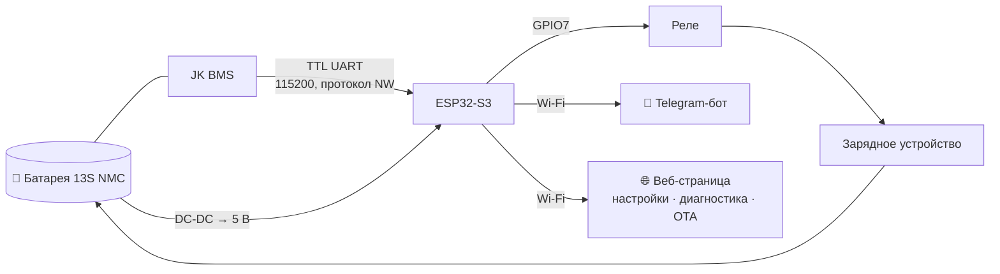

<div align="center">

# 🔋 JK BMS → Telegram

**Умный контроллер зарядки для домашней батареи на ESP32-S3**

Следит за JK BMS, включает зарядное устройство по напряжению с учётом ночного тарифа и графиков отключений,
сообщает в Telegram о пропаже и появлении света и отвечает на команды.


</div>

> Развитие проекта [jikongUart](https://github.com/Ramzess-II/jikongUart) (STM32, отключение заряда по SOC).
> Здесь — заряд по напряжению на ячейку, прогноз по профилю потребления, бот на несколько человек и обновление по воздуху.



## ✨ Возможности

**⚡ Заряд**
- **По напряжению с гистерезисом.** Пороги на ячейку: выключить на 4.05 В, снова включить на 3.90 В.
- **Ночной тариф:** ночью заряд включается ниже порога «включить».
- **Резерв на отключения:** днём заряд включается, если энергии меньше, чем нужно на N часов (по умолчанию 4) по выученному профилю.
- **Аварийный заряд** в любое время, если напряжение упало слишком низко.

**🏠 Свет и потребление**
- **Определение пропажи сети** по току разряда батареи: дом перешёл на инвертор.
- **Профиль потребления по часам** учится во время отключений и даёт прогноз «на сколько хватит».

**📱 Telegram**
- Бот на 1–4 получателя: вы, жена, группа. Два дома можно свести в одну группу.
- Уведомления о свете, заряде, тревогах BMS. Если не было интернета — с временем события.
- Команды, отправленные без связи, не теряются: выполнятся с пометкой об опоздании или бот честно скажет, что они устарели.

**🛡 Надёжность**
- Реле выключено при старте, без связи с BMS и без сети. Задачи под watchdog.
- **Обновление по воздуху** через веб-страницу или файлом в Telegram, с автоматическим откатом.
- **Диагностика без USB:** лог и дамп паники переживают перезагрузку, причина видна на `/log` и в Telegram.

**🌐 Веб-страница**
- Настройки по Wi-Fi, а без Wi-Fi — через собственную точку доступа.
- Живая проверка связи с BMS (что не так с пайкой) и кнопки теста реле.

## 🚀 Быстрый старт

```powershell
. "$env:IDF_PATH\export.ps1"
idf.py set-target esp32s3
idf.py -p COM5 flash monitor
```

1. Подключитесь к Wi-Fi **`JK-BMS-Setup`** (пароль `jkbms1234`) и откройте **http://192.168.4.1**.
2. Впишите домашний Wi-Fi и токен бота от [@BotFather](https://t.me/BotFather), сохраните.
3. Нажмите **Start** в боте, впишите присланный chat_id на странице — придёт `✅ Устройство запущено`.

Подробно — в разделах ниже.

## 📑 Содержание

1. [Железо](#1-железо)
2. [Сборка и прошивка](#2-сборка-и-прошивка)
3. [Создание Telegram-бота](#3-создание-telegram-бота)
4. [Первая настройка](#4-первая-настройка)
5. [Несколько пользователей и два дома](#5-несколько-пользователей-и-два-дома)
6. [Команды бота](#6-команды-бота)
7. [Как работает логика заряда](#7-как-работает-логика-заряда)
8. [Веб-страница настроек](#8-веб-страница-настроек)
9. [Диагностика: проверка пайки, тест реле, лог](#9-диагностика-проверка-пайки-тест-реле-лог)
10. [Обновление прошивки по воздуху](#10-обновление-прошивки-по-воздуху-ota)
11. [Если пропал интернет](#11-если-пропал-интернет)
12. [Первая проверка на месте](#12-первая-проверка-на-месте)
13. [Частые проблемы](#13-частые-проблемы)

---

## 1. Железо

| Что | Куда (по умолчанию) |
|---|---|
| Плата | ESP32-S3 Pico |
| BMS TX → ESP RX | **GPIO18** |
| BMS RX ← ESP TX | **GPIO17** |
| BMS GND | GND ESP |
| Реле зарядного устройства | **GPIO7** (активный уровень — высокий) |
| Кнопка настройки | BOOT (**GPIO0**), уже есть на плате |
| Питание | DC-DC от батареи (13S, вход до ~60 В) → 5 В |

Пины меняются в [main/config.h](main/config.h).

> ⚠️ На разъёме GPS/UART у JK может быть вывод с **напряжением батареи**. Прозвоните разъём мультиметром до подключения к ESP. Уровни TX/RX должны быть 3.3 В.
>
> Поставьте **подтяжку 10 кОм к GND** на вход управления реле, чтобы при загрузке ESP оно гарантированно было выключено.

Для работы Telegram во время отключений **роутер тоже должен питаться от батареи или UPS**.

---

## 2. Сборка и прошивка

```bash
idf.py set-target esp32s3
```
```bash
idf.py build
```
```bash
idf.py -p COM5 flash monitor
```

COM-порт подставьте свой. Первый раз (и после смены `partitions.csv`) прошивать нужно по проводу, дальше можно по воздуху (раздел 10).

`sdkconfig` не хранится в репозитории: он собирается из [sdkconfig.defaults](sdkconfig.defaults) (разметка OTA, откат, watchdog 60 с, 16 сокетов). Если у вас остался старый `sdkconfig`, удалите его перед сборкой. Слишком короткий watchdog или мало сокетов прошивка не даст собрать — проверки стоят в коде. Настройки в NVS при прошивке сохраняются.

Файл `main/secrets.h` необязателен: всё настраивается на веб-странице. Если хотите вшить начальные Wi-Fi и токен, скопируйте [main/secrets.h.example](main/secrets.h.example) в `main/secrets.h`. Он в `.gitignore`.

> Если `idf.py` в PowerShell жалуется на отсутствующее окружение Python, укажите его явно:
> `$env:IDF_PYTHON_ENV_PATH = "C:\Users\<user>\.espressif\python_env\idf5.5_py3.11_env"` перед `export.ps1`.

---

## 3. Создание Telegram-бота

1. В Telegram найдите **@BotFather** (официальный, с синей галочкой) и отправьте `/newbot`.
2. **Имя** — то, что видно в чате, например `Батарея Дом 1`.
3. **Username** — уникальный, заканчивается на `bot`, например `dom1_battery_bot`.
4. BotFather пришлёт **токен** вида `7123456789:AAHk3...`.

> ⚠️ Токен — как пароль. Если он утёк: @BotFather → `/mybots` → ваш бот → **API Token** → **Revoke**, затем вставьте новый токен на веб-странице устройства.

**Меню команд (по желанию).** Отправьте @BotFather `/setcommands`, выберите бота и вставьте одним сообщением:

```
status - Состояние батареи, сети и заряда
cells - Напряжения ячеек
profile - Потребление по часам и прогноз
charge_on - Включить заряд вручную
charge_off - Запретить заряд
auto - Автоматический режим
settings - Настройки и адрес веб-страницы
help - Список команд
```

В чате с ботом появится кнопка **«Меню»**.

---

## 4. Первая настройка

1. После прошивки устройство поднимает Wi-Fi-точку **`JK-BMS-Setup`**, пароль **`jkbms1234`**.
2. Подключитесь к ней телефоном и откройте **http://192.168.4.1**. Логин любой, пароль тот же.
3. Впишите **Wi-Fi** и **токен бота**. «Получатели» пока оставьте пустыми. Нажмите **«Сохранить и перезагрузить»**.
4. Откройте своего бота в Telegram и нажмите **Start**.
5. Бот ответит: `⛔ Нет доступа. Ваш chat_id: 123456789`.
6. Снова откройте страницу настроек (см. «Где найти страницу настроек»), впишите chat_id в «Получатели» и сохраните.
7. После перезагрузки придёт `✅ Устройство запущено`.
8. **Смените пароль страницы** (минимум 8 символов). Он же — пароль точки доступа.

> **Бот не может написать человеку первым.** Каждый получатель должен хотя бы раз открыть бота и нажать **Start**.

### Где найти страницу настроек

- В Telegram: команда `/settings`, внизу будет ссылка `http://<IP>`.
- Или IP устройства в списке клиентов роутера.
- Или удерживайте кнопку **BOOT 3 секунды**: на 30 минут поднимется точка `JK-BMS-Setup`, страница на `http://192.168.4.1`.
- Точка доступа включается и сама, если к домашнему Wi-Fi не удаётся подключиться 3 минуты.

Забыли пароль страницы? Остаётся только полная очистка флеша и прошивка заново:

```bash
idf.py -p COM5 erase-flash flash
```

---

## 5. Несколько пользователей и два дома

**Жена (или кто-то ещё).** Она открывает бота и нажимает **Start**. Бот присылает ей её chat_id. Вы дописываете его на странице через запятую: `123456789, 987654321`. Максимум 4 получателя.

- Уведомления получают все.
- Команды принимаются от любого из списка.
- Ответ на команду приходит только тому, кто спросил.

**Группа.** Создайте группу, добавьте себя, жену и бота. Напишите в группе `/start@dom1_battery_bot`. Бот ответит chat_id **группы** — он отрицательный, `-100…`. Впишите его в «Получатели».

**Два дома.** Нужно **два бота**, на каждое устройство свой токен: один токен нельзя опрашивать с двух устройств, будет ошибка 409. Оба бота добавьте в одну группу и дайте устройствам разные названия («Дом 1», «Дом 2»): название стоит в начале каждого сообщения. Команды в такой группе адресуйте конкретному боту: `/status@dom1_battery_bot`.

---

## 6. Команды бота

| Команда | Что делает |
|---|---|
| `/status` | Напряжение, SOC, ток, мощность, ячейки, температуры, есть ли сеть, состояние заряда и причина, запас энергии и прогноз, резерв |
| `/cells` | Все ячейки, отмечены самая высокая ⬆ и самая низкая ⬇ |
| `/profile` | Потребление дома по часам суток и прогноз от текущего заряда |
| `/charge_on [ч]` | Включить заряд вручную (по умолчанию на 3 ч). Всё равно выключится на пороге «выключить» |
| `/charge_off [ч]` | Запретить заряд (по умолчанию на 3 ч) |
| `/auto` | Вернуть автоматический режим |
| `/settings` | Текущие настройки и ссылка на веб-страницу |
| `/profile_reset` | Забыть выученный профиль потребления |
| `/help` | Список команд |

**Уведомления:**

- ⚡ **Свет пропал** — заряд и прогноз, на сколько хватит.
- 💡 **Свет появился** — сколько не было света, сколько кВт·ч израсходовано, SOC до/после.
- 🪫 При отключении осталось меньше 2 ч или SOC ниже 20 %.
- 🔌 / 🔋 Заряд включён или выключен, с причиной.
- 🚨 Тревоги BMS и их снятие.
- ⚠️ BMS не отвечает (заряд выключен) / ✅ связь восстановлена.
- ✅ Устройство запущено.

---

## 7. Как работает логика заряда

Пороги задаются **на ячейку** и умножаются на число ячеек. Значения для 13S:

| Порог | На ячейку | 13S |
|---|---|---|
| Выключить заряд | 4.05 В | 52.65 В |
| Включить снова / ночью | 3.90 В | 50.70 В |
| Аварийно включить | 3.60 В | 46.80 В |
| Аварийный — минимум до | 3.70 В | 48.10 В |

Каждую секунду:

1. **Нет данных от BMS** дольше 15 с, **нет сети** или ручной запрет → реле **выключено**.
2. Напряжение **≥ «выключить»** → реле выключено. Снова включится только после падения до «включить»: это гистерезис, чтобы реле не щёлкало.
3. Ручной режим `/charge_on` → заряжаем до порога «выключить».
4. Иначе заряд включается по первой подходящей причине:
   - **аварийно** — напряжение ≤ «аварийно включить», заряд держится минимум до «аварийный — минимум до»;
   - **резерв** — доступной энергии меньше, чем нужно на N часов вперёд по профилю. Заряд держится до резерва + 15 %;
   - **ночной тариф** — ночью и напряжение ≤ «включить». Заряд держится до «выключить».
5. Реле переключается не чаще раза в минуту. Аварийное выключение — сразу.

**Доступная энергия** = (SOC − мин. SOC) × ёмкость × 3.7 В × число ячеек. Ёмкость берётся из настроек BMS или задаётся на странице.

**Профиль потребления.** Пока есть сеть, дом питается от неё, и батарея его потребление не видит. Поэтому профиль учится только во время отключений: за каждый час суток считается средняя мощность и сглаживается с прошлыми значениями. Пока данных нет, используется «нагрузка по умолчанию» (300 Вт). Посмотреть профиль — `/profile`.

**Определение сети.** Если батарея отдаёт больше 1 А дольше 10 с, считаем, что сети нет. Если меньше 0.5 А в течение 30 с — сеть вернулась. Пороги подберите по `/status`: посмотрите ток при сети и без неё.

---

## 8. Веб-страница настроек

Что можно поменять:

- **Связь:** название, Wi-Fi, токен, получатели, пароль страницы. Пустые поля паролей и токена означают «оставить как есть».
- **Батарея:** число ячеек, ёмкость (0 = из BMS), минимальный SOC.
- **Пороги заряда** на ячейку, рядом сразу видно напряжение на весь пакет.
- **Ночной тариф:** часы начала и конца. Одинаковые часы — тарифа нет.
- **Резерв:** часы, запас сверху в %, нагрузка по умолчанию.
- **Определение сети:** пороги тока, инверсия знака тока BMS.

После сохранения устройство перезагружается. Кнопка «Сбросить пороги по умолчанию» не трогает Wi-Fi, бота и получателей.

Значения по умолчанию лежат в [main/config.h](main/config.h) (`DEF_*`).

---

## 9. Диагностика: проверка пайки, тест реле, лог

Всё это на той же веб-странице, без USB.

**Связь с BMS.** Блок обновляется раз в 2 с и сразу говорит, что не так:

| Статус | Что проверить |
|---|---|
| ✅ BMS отвечает, данные верные | Всё в порядке |
| ❌ BMS молчит, ни одного байта | Общий GND, TX/RX накрест, BMS не спит. Попробуйте поменять TX и RX |
| ⚠️ Приходят байты, но не кадры JK | Скорость, помехи, нет общего GND, уровень 5 В без делителя |
| ⚠️ Кадр битый или обрывается | Плохой контакт, длинные провода, помехи |
| ⚠️ ESP получает собственный запрос | TX и RX замкнуты между собой |

Там же счётчики опросов, сырые байты ответа и все ячейки (максимальная — красным, минимальная — синим).

**Реле зарядки.** Кнопки «Вкл на 10 с», «Вкл на 5 мин», «Выключить» и текущее состояние пина. Тест работает и без BMS, затем реле само возвращается к автоматике. Не включается, если сети нет или батарея уже заряжена.

**Лог: `http://<IP>/log`.** Лог и дамп паники хранятся в RTC-памяти и переживают перезагрузку. На странице — причина последней перезагрузки (паника, watchdog, просадка питания), время работы, лог прошлого запуска с `Backtrace` и текущий лог. После аварийной перезагрузки бот сам присылает причину и `Backtrace`. Расшифровать адреса:

```bash
xtensa-esp32s3-elf-addr2line -pfiaC -e build/JkongTelegramm.elf 0x42019ECA 0x4201A330
```

Если плату уронила команда из Telegram, после перезагрузки она пропускается, и бот пишет, какая именно, — иначе Telegram отдавал бы её снова и плата перезагружалась бы по кругу.

---

## 10. Обновление прошивки по воздуху (OTA)

Флеш разбит на два слота по 1.875 МБ ([partitions.csv](partitions.csv)). Новая прошивка пишется в свободный слот, пока старая работает.

Сначала соберите прошивку (`idf.py build`). Нужен файл **`build/JkongTelegramm.bin`** — не `bootloader.bin` и не `partition-table.bin`. Перед сборкой поднимите версию в [CMakeLists.txt](CMakeLists.txt) (`PROJECT_VER`), чтобы видеть, что обновление прошло.

**Через веб-страницу.** Внизу страницы блок «Обновление прошивки»: выберите файл, нажмите «Загрузить прошивку». Работает и через точку доступа `JK-BMS-Setup`.

**Через Telegram** (удобно для второго дома):
- в личном чате с ботом — просто отправьте файл `.bin`. Ваш личный chat_id должен быть в списке получателей;
- в группе — отправьте файл **ответом (reply) на сообщение нужного бота** или упомяните его в подписи (`@house1_bot`). Так бот второго дома файл не возьмёт.

Бот ответит «Скачиваю…», затем «Обновляю прошивку: 1.1.0 → 1.2.0, перезагружаюсь».

**Защита от неудачной прошивки.** После перезагрузки новая версия работает «на пробу». Она подтверждает себя, если через 30 с снова работает всё, что работало до обновления: BMS, Wi-Fi, Telegram. Тогда приходит «✅ Прошивка обновлена». Если за 5 минут этого не случилось, или прошивка зависла или перезагрузилась (watchdog), загрузчик **сам вернёт предыдущую версию**, и бот напишет «⚠️ Новая прошивка не запустилась нормально».

Пока новая версия не подтвердилась, следующее обновление не примется.

Проверки при загрузке: файл должен быть прошивкой ESP32-S3 этого же проекта (`JkongTelegramm`), образ проверяется по контрольной сумме. Обновлять могут только получатели из списка.

Текущая версия видна в `/settings`, в сообщении о запуске и на веб-странице.

---

## 11. Если пропал интернет

При отключении света роутер часто перезагружается, и связи нет несколько минут. Управление зарядом от интернета не зависит: сеть определяется по току BMS, время идёт по внутренним часам.

- **Уведомления** ждут в очереди (32 места) и уходят, когда связь вернётся. Если сообщение пролежало дольше минуты, в конце будет `🕒 Случилось в 14:32, доставлено с опозданием 3 ч 05 мин`.
- **Команды**, отправленные боту без связи, Telegram отдаст позже:
  - до 2 мин — как обычно;
  - 2–30 мин — выполняется, ответ начинается с `⏱ Команда пришла с опозданием N мин`;
  - старше 30 мин — не выполняется, бот отвечает `⏭ … слишком старая, отправьте снова`.
- Возраст команды считается по часам самого Telegram (заголовок `Date` его ответов), поэтому верен и сразу после перезагрузки, ещё до синхронизации по NTP.
- Очередь хранится в памяти: если плата перезагрузится, пока интернета нет, неотправленные уведомления пропадут.

---

## 12. Первая проверка на месте

1. `/status` при **включённом заряде** — ток должен быть **положительным**. Если он отрицательный, отметьте на странице «Инвертировать знак тока BMS».
2. `/status` при сети и при отключении (или выключите автомат) — запишите ток разряда. При необходимости поправьте пороги «Сеть пропала / вернулась».
3. `/cells` — должно быть 13 ячеек с правдоподобными напряжениями.
4. Если в `/status` написано «Ёмкость неизвестна», укажите ёмкость на странице.

---

## 13. Частые проблемы

| Симптом | Что проверить |
|---|---|
| Бот молчит совсем | Токен на странице. В логе (`idf.py monitor`) будет «неверный токен бота» |
| Бот отвечает «Нет доступа» | Ваш chat_id не вписан в «Получатели» или в номере опечатка |
| Уведомления не приходят жене | Она не нажала **Start** в боте |
| В логе ошибка `409` | Этот токен опрашивает другое устройство или скрипт. Один токен — одно устройство |
| «BMS не ответила ни разу» | TX/RX перепутаны, нет общего GND, не та скорость (115200) |
| Не пришло «Свет пропал» | Пороги тока в разделе «Определение сети» |
| В `/status` «время не синхронизировано» | Нет интернета: ночной тариф не учитывается, пока время не придёт по NTP |
| «Нет слота для обновления» | На плате старая разметка без OTA — один раз прошейте по проводу |
| Бот не реагирует на файл в группе | Отправьте файл ответом на сообщение бота или в личку боту |
| После OTA пришло «вернулась версия …» | Новая прошивка не увидела BMS/Wi-Fi/Telegram за 5 минут или перезагрузилась. Смотрите `/log` |
| Плата перезагружается каждые ~6.5 с, в логе `task_wdt … tg_send` | Watchdog 5 с вместо 60: старый `sdkconfig`. Удалите его и соберите заново. В ESP-IDF 5.5 больше 60 с поставить нельзя — значение молча сбрасывается на 5 |
| Пропала веб-страница, а плата пингуется | Роутер выдал другой IP. Посмотрите `/settings` в боте и закрепите адрес за платой в роутере |
| Бот не ответил на команду | Если интернета не было больше 30 мин, команда устарела — бот так и напишет. Иначе смотрите `/log` |

---

## Структура проекта

| Файл | Назначение |
|---|---|
| [main/config.h](main/config.h) | Значения по умолчанию, пины, тайминги |
| [main/settings.c](main/settings.c) | Настройки в NVS, проверка значений |
| [main/jk_bms.c](main/jk_bms.c) | UART и разбор протокола JK |
| [main/energy.c](main/energy.c) | Профиль потребления и прогноз |
| [main/control.c](main/control.c) | Главный цикл: сеть, реле, уведомления |
| [main/net.c](main/net.c) | Wi-Fi, точка доступа, кнопка BOOT, NTP |
| [main/web.c](main/web.c) | Веб-страница: настройки, диагностика BMS, тест реле, `/log`, OTA |
| [main/diag.c](main/diag.c) | Лог и дамп паники в RTC-памяти, причина перезагрузки |
| [main/telegram.c](main/telegram.c) | Отправка и приём сообщений бота |
| [main/commands.c](main/commands.c) | Команды бота |
| [main/ota.c](main/ota.c) | Обновление по воздуху, подтверждение и откат |
| [partitions.csv](partitions.csv) | Разметка флеша: NVS + два слота прошивки |

---

История разработки, принятые решения и найденные проблемы — в [docs/HISTORY.md](docs/HISTORY.md).
